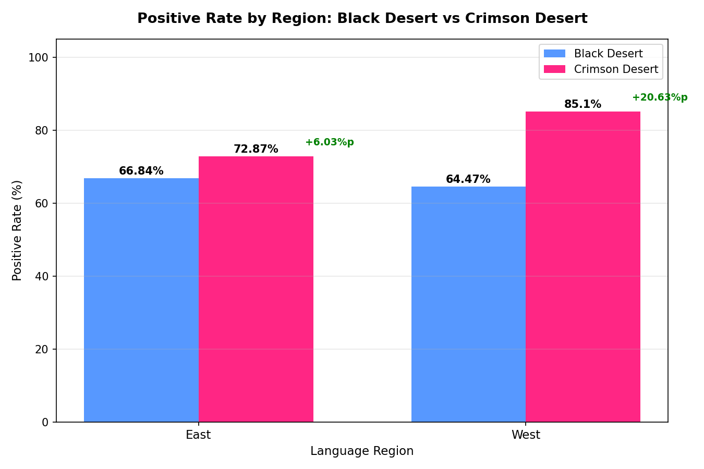
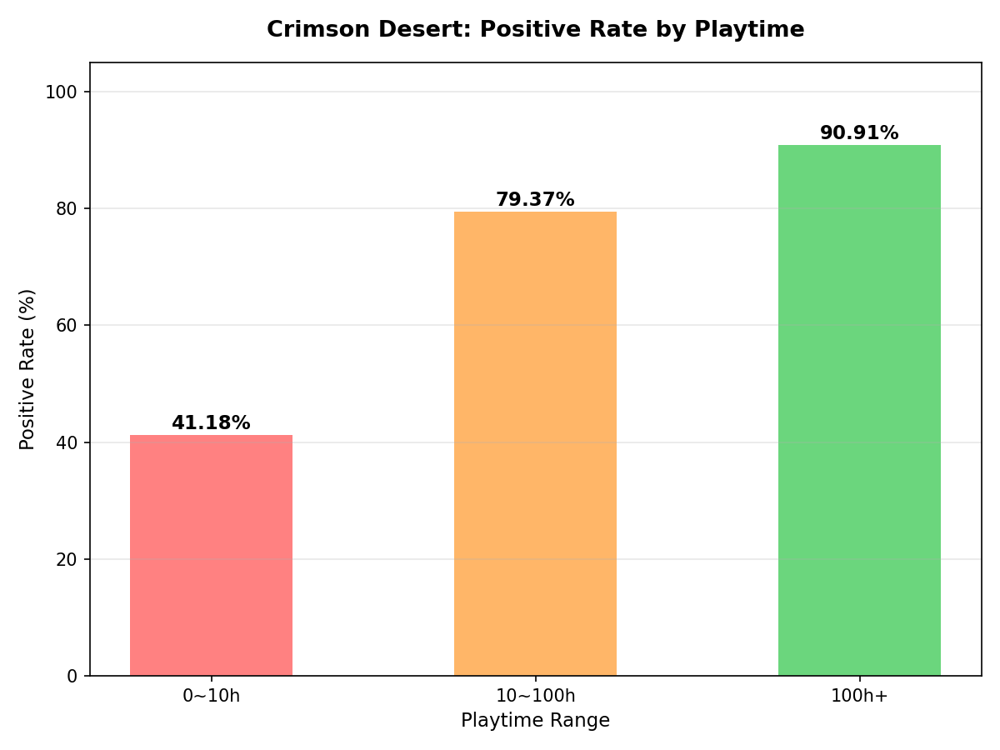

# 펄어비스 글로벌 시장 확대 성과 분석
### Steam 리뷰 25만 건 기반 빅데이터 파이프라인 (붉은사막 vs 검은사막)

| 항목 | 내용 |
|---|---|
| **기간** | 2026.05 ~ 2026.06 |
| **형태** | 개인 프로젝트 (빅데이터 과목 기말 프로젝트) |
| **역할** | 데이터 수집 · 파이프라인 구축 · 분석 · 시각화 전 과정 |
| **기술** | Python · HDFS · Apache Hive · Apache Spark · Spark MLlib · Matplotlib · Seaborn |
| **실행 환경** | Google Cloud(GCP) VM 위에 구성한 HDP Sandbox |
| **데이터** | Steam 공개 리뷰 API, **249,542건** (붉은사막 199,592 / 검은사막 49,950) |

---

## 30초 요약

| 구분 | 내용 |
|---|---|
| **문제** | 붉은사막은 전작(검은사막)의 약점이던 **서양 시장** 공략에 성공했는가? |
| **해결** | Steam 리뷰 **249,542건** 수집 → HDFS → Spark 전처리 → Hive 집계 → Spark MLlib → 시각화, `run_pipeline.sh` 하나로 자동화 (GCP VM 위 HDP Sandbox) |
| **결과** | 서양권 긍정률 **64.47% → 85.10% (+20.63%p)**, 동양권 상승폭(+6.03%p)의 3배 이상. 플레이타임 10시간 미만 리뷰어의 긍정률은 41.2%에 그침 |
| **내 역할** | 개인 프로젝트. 수집부터 시각화까지 전 과정 |
| **코드로 확인** | [`collect_reviews.py`](src/ingest/collect_reviews.py) 수집 · [`preprocess.py`](src/pipeline/preprocess.py) 전처리 · [`hive_setup.hql`](src/pipeline/hive_setup.hql) 집계 · [`spark_analysis.py`](src/pipeline/spark_analysis.py) 분석·MLlib |

## 1. 프로젝트 배경

펄어비스는 전작 **검은사막**으로 글로벌 시장에 진출했지만, 서양권 반응은 상대적으로 약했습니다.
2026년 3월 출시한 신작 **붉은사막**은 Steam에서 약 20만 건의 리뷰가 쌓이며 큰 주목을 받았습니다.

> **"붉은사막 출시로 펄어비스는 글로벌(서양) 시장 확대에 성공했는가?"**
> 이 질문을 감이 아니라 **실제 유저 리뷰 데이터로 검증**하는 것이 이 프로젝트의 출발점입니다.

## 2. 목표

1. 대용량 리뷰 데이터를 **수집 → 적재 → 처리 → 분석 → 시각화**까지 자동으로 처리하는 빅데이터 파이프라인 구축
2. Hive(집계)와 Spark(조인·심화 분석·ML)를 **역할에 맞게 나누어** 활용
3. 아래 4가지 분석 질문에 데이터로 답하기

| # | 분석 질문 |
|---|---|
| Q1 | 붉은사막은 전작 대비 **서양권**에서 더 좋은 반응을 얻었는가? |
| Q2 | 붉은사막에 대한 **동양권 vs 서양권** 긍정 평가 비율 차이는? |
| Q3 | **플레이 시간이 길수록** 긍정 평가를 하는 경향이 있는가? |
| Q4 | 출시 이후 **리뷰 수 추이**로 글로벌 확산이 확인되는가? |

## 3. 파이프라인 아키텍처

```
 [수집]  Python + Steam Review API (cursor 페이지네이션, 재시도 처리)
    │     └ 붉은사막 20만 / 검은사막 5만 건 CSV 저장
    ▼
 [적재]  원본 CSV → GCP VM(HDP Sandbox) 전송 → HDFS 업로드
    ▼
 [처리]  Spark DataFrame → Parquet 저장
    │     └ 타입 정리, 중복·결측 제거, 동양(East)/서양(West) 분류, 플레이타임 구간 생성
    ▼
 [분석]  Hive (HiveQL)                    Spark + MLlib
         ├ 게임 × 언어권 긍정률 집계        ├ 두 게임 언어권별 긍정률 JOIN · 변화량
         ├ 플레이타임 구간별 긍정률         ├ 플레이타임 패턴 비교, 평균 플레이타임
         └ 동서양 플레이타임 분포 (윈도우)   ├ 출시 초반 vs 이후 리뷰 수
                                           └ 로지스틱 회귀(긍정 여부 예측) AUC 비교
    ▼
 [시각화] Matplotlib / Seaborn → 차트 7종
```

전 과정을 `run_pipeline.sh` 한 번으로 실행할 수 있도록 자동화했습니다.

### 핵심 HiveQL ([전체 쿼리](src/pipeline/hive_setup.hql))

**① 게임 × 언어권 긍정률**: `CASE WHEN` 조건부 집계로 긍정 수와 긍정률을 한 번에 계산했습니다.
```sql
SELECT
  game_title,
  language_region,
  COUNT(*) AS total,
  SUM(CASE WHEN voted_up = true THEN 1 ELSE 0 END) AS positive,
  ROUND(SUM(CASE WHEN voted_up = true THEN 1 ELSE 0 END) * 100.0 / COUNT(*), 2) AS positive_rate
FROM reviews_processed
GROUP BY game_title, language_region
ORDER BY game_title, language_region;
```

**② 언어권별 플레이타임 분포**: 윈도우 함수 `SUM(...) OVER (PARTITION BY ...)`로 언어권마다 구간 비율의 합이 100%가 되도록 계산했습니다.
```sql
SELECT
  language_region,
  playtime_range,
  COUNT(*) AS total,
  ROUND(COUNT(*) * 100.0 / SUM(COUNT(*)) OVER (PARTITION BY language_region), 2) AS ratio
FROM reviews_processed
WHERE game_title = 'crimson_desert'
GROUP BY language_region, playtime_range;
```

| language_region | playtime_range | total | ratio |
|---|---|--:|--:|
| East | 0~10h | 3,826 | 7.88% |
| East | 10~100h | 24,287 | 50.04% |
| East | 100h+ | 20,426 | 42.08% |
| West | 0~10h | 9,634 | 6.38% |
| West | 10~100h | 69,593 | 46.07% |
| West | 100h+ | 71,826 | 47.55% |

<sub>결과: [`results/csv/hive_result3_playtime_dist.csv`](results/csv/hive_result3_playtime_dist.csv)에서 발췌</sub>

## 4. 핵심 결과

| 분석 | 결과 |
|---|---|
| **서양권 긍정률** | 검은사막 64.47% → 붉은사막 **85.10% (+20.63%p)** |
| **동양권 긍정률** | 검은사막 66.84% → 붉은사막 72.87% (+6.03%p) |
| **플레이타임별 긍정률** (붉은사막) | 0~10h **41.2%** → 10~100h 79.4% → 100h+ **90.9%** |
| **플레이타임-긍정 상관계수** | 0.294 |
| **긍정 여부 예측 모델 AUC** | 붉은사막 0.711 / 검은사막 0.645 |

<p align="center">
  
  
</p>

### 결론
- **Q1 · Q2 →** 긍정률 상승 폭이 서양권(+20.6%p)에서 동양권(+6.0%p)보다 3배 이상 컸습니다. 붉은사막은 **서양 시장에서 전작의 약점을 뚜렷하게 개선**했습니다.
- **Q3 →** 플레이 시간이 길수록 긍정률이 높아졌습니다. 반대로 <b>플레이타임 10시간 미만 리뷰어의 긍정률은 41%</b>에 그쳐, 초반 경험(온보딩, 튜토리얼) 개선이 다음 과제로 보입니다.
- **Q4 →** 출시 후 리뷰가 꾸준히 누적되었습니다(초반 1개월 1,078건 → 이후 198,514건).

> 그 밖의 차트(플레이타임 분포·패턴, 평균 플레이타임, 리뷰 추이, 모델 AUC)는 [`results/charts/`](results/charts)에 있습니다.

## 5. 한계 및 개선 방향

- **언어 = 지역 가정**: 리뷰 언어로 동/서양을 분류했기 때문에, 영어로 리뷰를 쓴 아시아 유저 등은 서양으로 분류됩니다.
- **표본 불균형**: 검은사막 동양권 리뷰는 1,134건으로 비교 표본이 작습니다.
- **표본 크기**: 과제 조건(원시 데이터 100MB 이상)을 충족하도록 수집 목표를 붉은사막 200,000건, 검은사막 50,000건으로 설정했습니다(합산 약 106MB, `src/ingest/collect_reviews.py`).
- **모델 피처**: 당시 예측 모델 피처는 2개(언어권, 플레이타임 구간)로 구성했습니다.

### 개선 방향
- **수집 방식**: 당시에는 Steam API 기본값으로 목표 건수만큼 수집했습니다. 다음에는 수집 전에 API의 `query_summary`로 게임별 전체 건수와 긍정률을 확인해 표본과 비교하고, 기간별로 나누어 수집해 대표성을 높이겠습니다.
- **동양권 표본 보강**: 검은사막 동양권은 언어별로 수집량을 늘려 비교 표본을 키우겠습니다.
- **모델 고도화**: 리뷰 텍스트 감성 분석(NLP) 피처를 추가해 설명력을 높이겠습니다.

## 6. 실행 방법

```bash
# 전체 파이프라인 (로컬 → GCP VM 위 HDP Sandbox에 SSH 접속, 접속 정보는 환경 변수로 변경 가능)
chmod +x run_pipeline.sh
SANDBOX_HOST=<샌드박스 주소> SANDBOX_PORT=2222 ./run_pipeline.sh

# 단계별 실행
python3 src/ingest/collect_reviews.py data/raw   # 1. 수집 (로컬)
spark-submit src/pipeline/preprocess.py          # 2. CSV → Parquet 전처리 (클러스터)
hive -f src/pipeline/hive_setup.hql              # 3. Hive 집계 (클러스터)
spark-submit src/pipeline/spark_analysis.py      # 4. Spark 분석 + MLlib (클러스터)
python3 src/analyze/visualization.py results     # 5. 시각화 (로컬)
```

> 실행 환경은 Google Cloud(GCP) VM 위에 구성한 HDP Sandbox입니다. `SANDBOX_HOST`에는 VM 주소를 넣고, SSH 포트 포워딩을 쓴다면 `localhost`를 그대로 두면 됩니다.
> 원본 리뷰 데이터는 용량 문제로 제외했고, 집계된 분석 결과 CSV만 `results/csv/`에 포함했습니다.
> `python3 src/analyze/visualization.py results`를 실행하면 클러스터 없이 포함된 결과만으로 차트를 다시 그릴 수 있습니다.
> 원본 데이터의 형태(Raw → Processed 예시)와 샘플 생성 방법(`make_sample.py`)은 [`data/README.md`](data/README.md)에 정리했습니다.

### 코드 개선 내역
| 개선 | 내용 |
|---|---|
| **전처리 단계 추가** | CSV → Parquet 변환과 `region`·`playtime_range` 파생 컬럼 생성을 [`preprocess.py`](src/pipeline/preprocess.py)로 분리해, Hive·Spark가 같은 입력을 쓰도록 했습니다 |
| **하드코딩 제거** | 시각화에서 직접 입력하던 결과값과, Spark에서 고정값으로 쓰던 전체 리뷰 수를 실제 데이터에서 계산하도록 바꿨습니다 |
| **결과 파일 로딩** | 여러 part 파일로 나뉜 Hive/Spark 출력을 모두 읽어 합치도록 수정했습니다 (행 누락 방지) |
| **수집 안정성** | 요청 타임아웃, 지수 백오프 재시도, 연속 실패 시 중단 로직을 추가했습니다 (무한 재시도 방지) |
| **실행 스크립트** | `src/` 구조에 맞게 경로를 정리하고, 환경 변수로 접속 정보를 바꿀 수 있게 했으며, 실패 시 즉시 중단(`set -euo pipefail`)하도록 했습니다 |

## 7. 디렉토리 구조

```
02-steam-review-bigdata/
├── run_pipeline.sh            # 전체 파이프라인 자동 실행 (7단계)
├── data/README.md             # 데이터 출처 · Raw/Processed 스키마
├── src/
│   ├── ingest/collect_reviews.py    # Steam API 수집
│   ├── pipeline/preprocess.py       # CSV → Parquet 전처리 · 파생 컬럼
│   ├── pipeline/hive_setup.hql      # Hive 테이블 · 집계 쿼리
│   ├── pipeline/spark_analysis.py   # Spark 분석 · MLlib
│   └── analyze/visualization.py     # 차트 생성
└── results/
    ├── csv/       # 분석 결과 테이블
    └── charts/    # 시각화 결과 7종
```

---

<sub>AI Tool Usage — Claude: 파이프라인 설계 검토, 디버깅 보조, 문서 작성 보조</sub>
